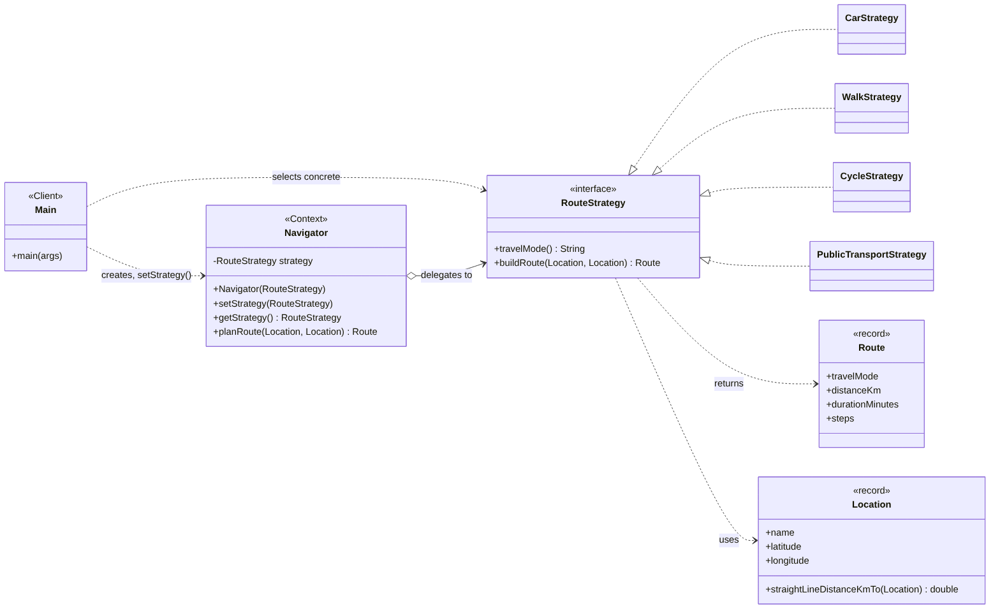

# Strategy Pattern — Navigation / Route Planning (Java 17)

Assignment #5, ShP-2216 Software Design Patterns, Astana IT University.
Author: Arlan Matzhan, group SE-2505.

A `Navigator` (Context) plans a route between two locations using an interchangeable `RouteStrategy`
(Car, Walk, Cycle, Bus). The strategy can be swapped at runtime; the Context contains no `if`/`switch` on the travel mode.

## Structure

```
src/main/java/kz/aitu/navigation/
├── Main.java                      Client: registers strategies, switches them at runtime
├── Navigator.java                 Context: holds a RouteStrategy, delegates planRoute()
├── Location.java                  record: name + coordinates, Haversine distance
├── Route.java                     record: result (mode, distance, duration, steps)
└── strategy/
    ├── RouteStrategy.java         Strategy interface
    ├── CarStrategy.java           Concrete strategy
    ├── WalkStrategy.java          Concrete strategy
    ├── CycleStrategy.java         Concrete strategy
    └── PublicTransportStrategy.java  Added last, no existing class modified (only the client registry)
src/test/java/.../NavigatorTest.java   dependency-free tests
docs/uml-class-diagram.png (+ uml.mmd) UML class diagram
```

## Run

Requires JDK 17+.

```bash
scripts/run.sh                 # demo: Car -> Walk -> Cycle -> Bus on the same Navigator
scripts/run.sh --interactive   # type car / walk / cycle / bus / exit
scripts/run-tests.sh           # tests
```

## Adding a new strategy

1. Create a class implementing `RouteStrategy`.
2. Register it in `Main.registerStrategies()`.

`Navigator` and the existing strategies are not touched.

## UML


